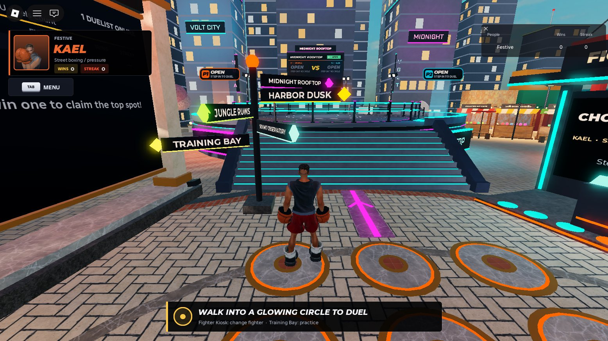

# FightingLab

An original, private Roblox 3D fighting game played as a duel lobby: you spawn in a plaza as your fighter, walk to
themed arenas, stand on glowing circles to duel other players or a CPU, and practise in a dojo. Six original fighters,
100 motion-captured or hand-keyed attacks, a CPU with three fair difficulty levels, and an automated anti-cheese pass.

This repository holds the Roblox place (`FightingLab.rbxlx`), every game script exported as text (`src/`), the
fighter specs, the build tools and the design docs. More screenshots: [docs/gallery](docs/gallery/README.md).

## How to play
1. Open FightingLab.rbxlx in Roblox Studio and press Play. You spawn in the lobby plaza as your fighter.
2. For the full PC view, pick "Current device" in the device dropdown at the top-left of the game view, then maximize
   the Studio window. (A phone preset shrinks the game, adds a phone frame and touch buttons.)
3. To try player-vs-player in Studio, use Test > Clients and Servers with 2 players (solo Play has one player).

The lobby ("Ember Square"): walk around the plaza, follow the signposts and floor guide lines to the five arenas, and
use the on-screen E prompts for everything. Change fighter at the Fighter Kiosk (E) or in the Tab menu.
- Duel arenas (Midnight Rooftop, Harbor Dusk, Jungle Ruins, Summit Observatory): two glowing circles each. Stand on
  one to wait; when someone stands on the other a countdown starts and you fight there, best of 3 rounds. Waiting
  alone? After a few seconds a "Fight CPU" prompt appears: press E and pick Easy / Normal / Hard.
- Training Bay dojo: the TRAIN circle opens free training or a 10-step guided lesson against a dummy (pick the dummy
  fighter); the CPU circle starts a practice match against the CPU.
- Wins and streaks go on the Hall of Champions board, and each arena's status board shows who is fighting.

## Controls
Lobby: WASD walk, Space jump, E interact (kiosk, circles, dojo), Tab lobby menu (Fighters, How to Play, Move List,
Settings, Credits).

Fighting (keyboard). The same scheme is shown in the fight (G), in How to Play and taught in the guided lesson:
- D walk forward, A walk back. Holding A (or standing still) is your standing guard: it blocks highs and mids.
- Double-tap D: dash. Double-tap A: backdash (chainable).
- Tap W: sidestep into the screen. Tap S: sidestep toward the camera. One step per tap, no circling.
- Hold S: crouch (crouch guard: blocks lows, ducks highs, but mids hit you).
- U = 1 (left punch), I = 2 (right punch), J = 3 (left kick), K = 4 (right kick). Directions + buttons pick moves
  (e.g. down-forward + 2), and buttons in sequence make strings (e.g. 1,2).
- O, U+J or I+K: throw. Break an incoming throw by pressing U or I as it starts (matching the throw's punch).
- G: controls guide.
- Practice: R reset positions, T Training / Versus CPU, 1 / 2 / 3 CPU difficulty, Y dummy mode (Stand / Guard /
  Fight back), P pause (opens the practice panel), Backspace leave practice.

Fighting (gamepad): stick or D-pad move, X / Y / A / B = 1 / 2 / 3 / 4, RB throw, Start pause, Select guide.

## Roster and arenas
Kael (street boxing, pressure), Sierra (kickboxing, range), Goran (heavyweight brawler), Lumi (acrobatic kicks),
Rhys (traditional karate with a parry), Nia (fluid open-hand style). All six are original characters with realistic
catalog bodies and heads, fitted textured fightwear and facial expressions; each has 16-17 original moves.
Arenas: Midnight Rooftop, Harbor Dusk, Jungle Ruins, Summit Observatory (duels) and Training Bay (practice dojo).

## Repository layout

| Path | What it is |
|---|---|
| `FightingLab.rbxlx` | The game. Open it in Roblox Studio and press Play. |
| `src/` | Every game script exported as text (`<Full.Roblox.Path>.luau`), including the motion clip modules. `_classes.json` records each script's class; `export-manifest.json` lists them. |
| `characters/` | Fighter specs (body, head, outfit, hair, tints, gear and the catalog items they use): the source of `CharacterSpecs`. |
| `data/` | Credits inputs for the motion-capture libraries and arena sounds. |
| `tools/` | Script export/apply, data generation, credits and Studio capture helpers. `tools/mocap/` builds and checks motion clips; `tools/integration/` merged the parallel workstreams of Overhaul 6. |
| `docs/design/` | Design docs: controls and acceptance targets (`CONTRACTS-v6.md`), every move with frame data (`combat-states.md`), balance numbers, the motion clip format (`motioncore.md`), characters, world and UI notes. |
| `docs/research/motion/` | The licensed motion-capture catalog and research notes (the raw capture data is not stored here). |
| `docs/gallery/` | Screenshots of the current build. |
| `CREDITS.md` | Credits for every marketplace item, sound and motion-capture source. |

## Working on the game

The tools need Python 3 (standard library only; the motion tools in `tools/mocap` also use numpy, scipy and
matplotlib). If Windows blocks the scripts, run them as `powershell -ExecutionPolicy Bypass -File tools\<script>.ps1`.

- **Editing in Studio:** open `FightingLab.rbxlx`, make your changes and save to the same file. Then run
  `tools\export-sources.ps1` so script changes show up in `src/`, check them with `git diff`, and commit the place and
  `src/` together.
- **Editing scripts in VS Code:** edit the files in `src/`, close the place in Studio, run `tools\apply-sources.ps1`,
  then open the place and test. New files become ModuleScripts; name them `<Path>.server.luau` or `<Path>.client.luau`
  for a Script or LocalScript.
- **Changing a fighter's look:** edit `characters/<Id>.json`, run `tools\build-data.ps1` (regenerates `CharacterSpecs`
  and the credits), then `tools\apply-sources.ps1`. The server rebuilds that fighter on the next Play.
- **Tests:** press Play in Studio, then run `require(game.ServerStorage.UnitTest.RunUnitTest)(nil, 5)` in the server
  command bar. The result should end with `[SUMMARY] N run, N passed, 0 failed`.

## Architecture
- World: ServerScriptService.FightingLabWorldBoot sets the global lighting and builds workspace.FightingLabWorld from
  ServerStorage.FightingLab.World.* at server start (a compact ring district: central plaza, five arenas 66-70 studs
  from the centre, about 3,900 parts). Each arena has FightOrigin, pads, exits, a StatusBoard and a fight radius of
  21 studs with a visible edge. Client.LobbyAmbience animates pads, lights and arena ambience.
- Duels (server): ServerScriptService.FightingLabServer + ServerStorage.FightingLab.Duel.*. AvatarService spawns
  players as their fighter and keeps new characters hidden until dressed. DuelService watches the pads, offers CPU
  matches, handles forfeits, results and leaderstats (Wins, Streak). MatchHost runs a MatchRunner per arena at 60 Hz
  and sends snapshots to both fighters (and to players within NetProtocol.SpectatorRadius of the arena).
- Fight session (client): Client.FightSession switches between lobby mode and fight mode. Online duels are
  server-authoritative (inputs reach the screen after a network round trip); practice runs the MatchRunner locally,
  so it is instant. Client.SpectatorPresenter shows fights near you in the lobby.
- Controls: ReplicatedStorage.FightingLab.Controls is the single source of truth for keys and on-screen labels
  (Controls.legend / label / formatMoveInput). Client.InputController turns keys into sim commands (a sidestep is a
  one-frame pulse, so holding never orbits).
- Combat: ReplicatedStorage.FightingLab.CombatSim is deterministic and frame-based: automatic standing / crouching
  guard, discrete sidesteps, committed dash / backdash, strings and chords, throws with break windows, tracking and
  homing moves, real step-in root motion, hitstop, counter hits, launches, limited juggles (max 4 air hits),
  knockdowns, invulnerable getups and rolls, and practice-dummy modes. Moves and frame data live in Roster (each move
  also carries an animation-intent sentence); global tuning in CombatConfig.
- CPU: ReplicatedStorage.FightingLab.CombatAI perceives the opponent through a reaction delay per difficulty, blocks,
  punishes, uses strings, throws and footwork, reads repeated habits (with reads that fade over time) and has a
  per-difficulty patience timer so it never stays passive. Easy has a per-fighter matchup table so every fighter is
  winnable for a beginner.
- Animation: Client.Motion.ClipLibrary decodes motion clips (format FLClip1) and Client.Motion.ClipPlayer samples
  them; Client.MotionPlayer turns clip poses into R15 joint transforms with two-bone IK, a ground solver (lying bodies
  rest on the floor, nothing goes below it), planted-foot locking and a reach net (a grounded foot the leg cannot
  reach goes onto its ball and slides along the floor instead of lifting into the air). Clip modules:
  Client.Motion.Clips.Core.* (stances, walking, dashes, sidesteps, guards, hit reactions, falls, getups, rolls, KO,
  victory, defeat) and Client.Motion.Clips.Moves.Strikes / Kicks / Throws.* (one clip per move, 100 in total; throws
  have synchronised attacker and defender tracks, hand grips on the partner's body and break tracks). Clips are
  proportional, so one clip fits every fighter, and each attack clip is time-warped so its impact pose lands exactly on
  the move's first active frame. The older procedural Client.Motion.Strikes / Kicks / Throws remain as a fallback for
  any move without a clip.
- Fighters: ServerStorage.FightingLab.CharacterSpecs (generated from the JSON specs in `characters/` by
  `tools/build-data.ps1`) holds each fighter's body, head, clothing, hair, tints and gear. CharacterFactory builds the
  R15 avatar; ServerScriptService.FightingLabCharacterBoot rebuilds any saved template whose hash changed. To change a
  look by hand: edit the fighter's entry in CharacterSpecs AND change their string in `hashes`.
- Presentation: CharacterPresenter (fight rigs, pool, previews, contact-aim heights), CameraDirector, EffectsController,
  AudioController, FighterLighting, FaceController, HudController (health bars, timer, round pips, combo counter,
  call-outs, controls guide), LobbyUI (prompts, CPU picker, training picker, practice strip / pause panel, results,
  Tab menu), FighterSelect (showcase room), StationBoards, Leaderboard, CreditsScreen (renders
  ReplicatedStorage.FightingLab.Credits, generated by `tools/gen_credits.py` together with CREDITS.md).
- Making motion clips: `tools/mocap` (convert.py turns licensed motion capture into clip modules, keyed.py
  builds hand-keyed clips and two-person throws, clipsheet.py renders a clip offline exactly as the game plays it,
  cliplint.py checks credits headers, decoding and move keys). See `docs/design/motioncore.md`.
- Tests: ServerStorage.UnitTest. In Play, on the server: `require(game.ServerStorage.UnitTest.RunUnitTest)(nil, 5)`
  Final result: `[SUMMARY] 370 run, 370 passed, 0 failed`

## Update: shoes and hair (2026-10-12)

- Every fighter's shoes are sized like real shoes as worn (length, width and height checked against the fighter's
  height and bare foot by `CharacterLook_Test`): Kael wears sleek black high-top boxing boots, Lumi slim split-toe
  boots, Goran smaller combat boots, and Nia's slip-ons are now rigid and sized to her feet.
- Hair covers the whole scalp from every angle: Kael's cornrows reach the nape and Rhys wears a bun (Goran keeps his
  shaved head). A ray test checks the back, sides and top of every head.
- Shoes rest on the floor through knockdowns, rolls and getups: the ground solver now rests a visible foot on its
  shoe's ground box instead of the smaller bare foot inside it.

## Overhaul 6 changes (2026-10-12)
- Fighting that feels like a modern 3D fighter: deliberate walking, committed dashes and backdashes, one sidestep
  per tap (no more circling), guard by holding back or standing still and crouch guard by holding down (no guard
  button), throws you can break, strings, launchers that are punishable, limited juggles, invulnerable getups.
- New, clear control scheme (U / I / J / K = 1 / 2 / 3 / 4, O throw, G guide) used identically in fights, the guide,
  How to Play and the lesson; every lobby interaction is an E prompt.
- Motion-captured animation: stances, footwork, reactions, falls and getups from licensed motion capture (ACCAD,
  CMU, Quaternius), and all 100 attacks rebuilt as real clips (motion capture where it exists, careful hand-keying
  for the rest, including every two-person throw). Knocked-down and KO'd fighters lie on the floor.
- A fair CPU: Easy / Normal / Hard differ in reaction time, blocking, punishing and decision-making; a beginner can
  beat Easy with every fighter; the CPU no longer freezes in a crouch or gets cheesed by spamming one move.
- Anti-cheese pass backed by an automated exploit search: button mashing, jab pressure, single-move spam, turtling,
  wake-up loops and throw loops no longer beat the CPU.
- New compact map ("Ember Square") with every arena a short walk from the spawn, visible arena edges, and lighting
  tuned so fighters never wash out.
- Fighters re-proportioned (about 7 heads tall) with fitted fightwear that follows the body in every pose.
- New UI: premium fighter-select showcase, lobby menu, CPU picker, training picker and guided lesson, a practice
  panel that folds into a small strip while you fight, and a cleaner fight HUD with call-outs.

## Overhaul 5 changes (2026-10-10)
- The game is now a duel lobby: no title screen or menus. You spawn in a plaza as your fighter, walk to themed
  arenas, stand on glowing circles to duel other players (server-run, best of 3) or a CPU, and practise in the dojo.
- New world built in code: lobby plaza with Fighter Kiosk and Hall of Champions leaderboard, four duel arenas and a
  practice dojo, golden-hour lighting with Future lighting and textured 2022 materials.
- Fighters re-dressed with textured, detailed outfits (trims, prints, camo, knit, embroidery, belts, pads, tape,
  textured shoes); Sierra got colour; Goran's body was replaced for originality; Rhys's gi was changed so it doesn't
  resemble a well-known fighting-game outfit.
- No more bare-body flashes: new characters stay hidden until dressed and loaded, fight rigs are pooled, and HUD
  portraits wait for their clothing.
- Lobby UI: identity card with wins and streak, prompts, CPU offer, countdown, practice panel, result cards, toasts
  for other duels, Tab menu (fighters, move list, controls, credits, settings), arena status boards, leaderboard.
- Your own fighter is always on the left, including when you are player 2; other players who block the fight
  camera fade out. The new Roblox chat (TextChatService) replaces the legacy chat.

## Overhaul 4 changes (2026-10-10)
- New realistic cast: catalog bodies and heads chosen per fighter, style outfits (boxing gear, compression tops,
  a blue judo-style gi, a frog-button jacket with martial-arts trousers, grappler kit), hair, beard and gloves.
  Every costume was checked to stay original (no franchise or brand items, no look-alikes of existing characters).
- Facial expressions in fights, menus and the VS splash (FaceController).
- Kung-fu, flow and grappler stances retuned for the new bodies (no more "praying hands" or covering the mouth).
- New 3D character select: lit fighters on stage, style stats, portrait tiles, lock-in pose, CPU roulette, stage
  preview, VS splash.
- CREDITS screen and CREDITS.md.
- Fixes: the client could hang before the menu appeared when an asset preload stalled (preloads now run in the
  background); select tiles showed the fighters' backs and were ordered differently from the cursor; the VS overlay
  stayed over the fight when the splash timed out; menu titles crossed the header line; the mode list overflowed.

## Overhaul 3 changes (2026-10-10)
- Instant controls: local 60 Hz simulation instead of a server round trip with 20 Hz snapshots.
- New fighter looks: realistic bodies, layered outfits, hair, closed fists (gloves / wraps); bent-knee guards.
- Competitive CPU: fixed the long-range whiff-jab standoff; spacing, punishes, juggles; rounds end by KO.
- Snappier launches and juggles; the camera keeps both fighters (feet included) in frame.
- Brighter, readable stages and per-fighter lighting; duplicate saved stage effects removed.
- Local 2P VERSUS mode.
- Fixes: health bars now go down (the HUD rebuilt both portraits every frame and reset the bars, which also leaked
  memory up to ~29 GB on menus); menu previews show full outfits; the VS splash no longer runs a hidden match and
  can be skipped with Enter; pause really pauses; no more HIT / BLOCK / WHIFF popup spam; Roblox player list hidden.

## Known limitations
- Fighters are assembled from Roblox catalog / UGC avatar assets when the server starts, so Studio needs Roblox
  asset access (about 1-2 s on first Play).
- Online duels are server-authoritative, so inputs reach the screen after a network round trip (about 0.08-0.09 s
  in Studio, more on a real server). Practice in the dojo runs locally and is instant.
- No licensed two-person motion capture exists, so throws are hand-keyed; the fastest spins and flips are compressed
  to fit their frame data and move quicker than a real athlete would.
- Strikes are tuned to an average opponent, so on the tallest or shortest fighter a hit can land a little deep or
  short of the body surface.
- R15 rigs have no finger bones: open-hand fighters keep the catalog hand shape and Kael / Sierra wear gloves.
- Studio-only review hooks exist (the FightingLabDuelDebug bindable and a stub world that is only built when the real
  world is missing); they are ignored outside Studio.

## History and backups

- Every change is tracked in this repository (GitHub `yassinsolim/FightingLab`, private).
- Full copies of the place from before each overhaul (`backup-before-overhaul3.rbxlx` to
  `backup-before-overhaul6.rbxlx`) are kept outside the repository, in `C:\Users\solim\.copilot\session-state\e3751321-5f48-4183-b62a-9577765df8cf\files`.
